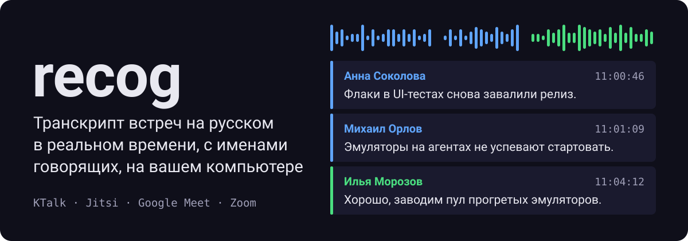
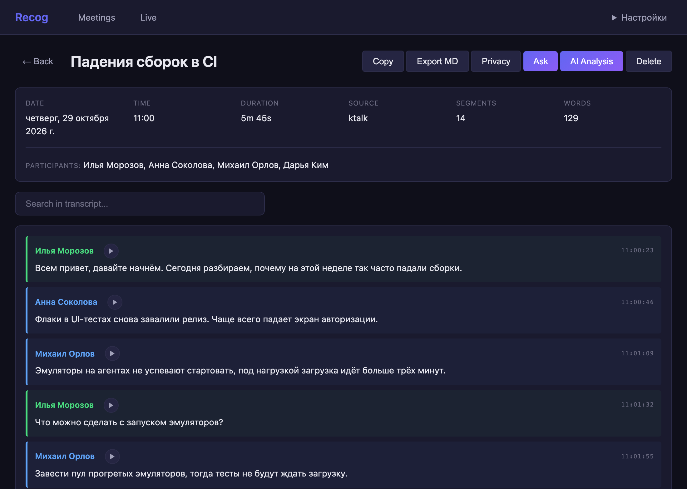
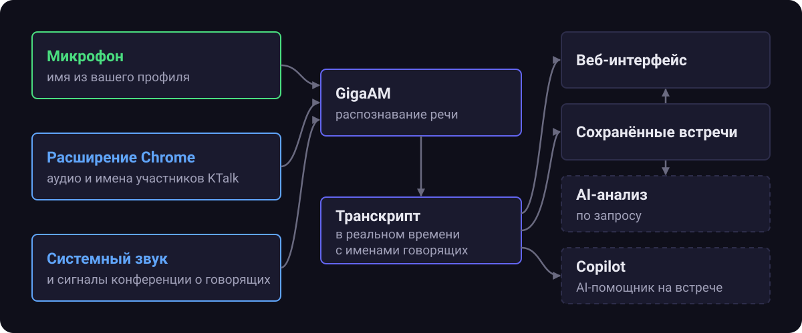

<p align="center">
  
</p>

# recog

Транскрибация русскоязычных встреч в реальном времени на вашем компьютере:
с именами говорящих, сохранением встреч и веб-интерфейсом.

[Сайт Recog](https://recog.vkkovalev.work/) · [Готовые сборки](https://github.com/materkey/recog/releases/latest)

<p align="center">
  
</p>
<p align="center"><sub>Настоящий веб-интерфейс recog, встреча и участники вымышленные.</sub></p>

## Что отличает recog

- **Имена из конференции, а не из голоса.** Имена говорящих берутся из сигналов об
  участниках конференции и из вашего профиля, а не из распознавания голоса.
- **Распознавание на вашем компьютере.** GigaAM по умолчанию работает локально;
  [удалённый шлюз распознавания](docs/asr-server.md) необязателен, как и Copilot с
  AI-анализом, которые используют CLI Claude и Codex.
- **Поддерживаемые конференции:** KTalk (Контур.Толк, `*.ktalk.ru`), Jitsi,
  Google Meet и Zoom (веб-клиент; приложение для macOS
  [включается отдельно](docs/zoom-app.md)). Для Element Call укажите свой
  сервер в [настройках конференций](docs/conference-hosts.md).

Готовые сборки выпускаются для Mac с Apple Silicon и для Linux x86-64.
На обеих системах проверили звонки Jitsi с двумя участниками, запись микрофона
и системного звука и остановку захвата после выхода.
[Протокол приёмки](docs/plans/2026-11-18-install-implementation.md)

## Как это работает

<p align="center">
  
</p>

Речь с микрофона подписывается именем из вашего профиля.
В режиме постоянной записи системный звук вне распознанной конференции
помечается как `Unknown`.

В веб-интерфейсе есть живые и сохранённые транскрипты, воспроизведение аудио и
AI-анализ. Copilot запускается из веб-интерфейса; автоматический старт на встречах
в новых установках выключен. Новые установки хранят встречи, логи и профиль
пользователя в `~/.recog`, настройки установки — в `~/.config/recog/config.toml`.

Чтобы Claude Code мог искать по сохранённым встречам из любого проекта, установите
скилл [`recog-meetings`](.claude/skills/recog-meetings/SKILL.md) в свой профиль:

```sh
npx -y skills add materkey/recog@recog-meetings -g -a claude-code -y
```

Откройте новый сеанс Claude Code в любой папке и задайте вопрос о встрече.
Для установки нужен Node.js с `npx`, для поиска по участникам, словам и датам — `uv`.

## Установка

> [!IMPORTANT]
> Новая установка начинает захватывать микрофон и системный звук, когда recog
> обнаруживает поддерживаемую конференцию, и закрывает захват после выхода.
> Для звонков в браузере загрузите расширение Chrome. Обновление сохраняет
> существующий режим записи. Аудио встреч удаляется через 24 часа, транскрипты
> хранятся, пока вы их не удалите. Предупредите участников и убедитесь, что запись
> разрешена. `recog service stop` останавливает сервисы и запись.

### Mac с Apple Silicon (macOS 13 и новее)

1. [Скачайте образ Recog для Mac](https://github.com/materkey/recog/releases/latest/download/Recog-macOS-arm64.dmg)
   и откройте его.
2. Перетащите **Recog.app** в **Applications (Программы)**, затем откройте
   приложение оттуда и запустите настройку. Всё для записи и воспроизведения
   уже в образе. При первой настройке Recog скачает модель распознавания
   (около 274 МБ).
3. В окне Recog откройте разрешения для микрофона и системного звука.
   Для звонков в браузере приложение покажет папку готового расширения Chrome.

Начиная с 0.3.0 Recog проверяет обновления через Sparkle. В меню **Recog →
Проверить обновления…** можно проверить и установить новую версию, а в этом же
меню — отключить автоматические проверки. Если у вас исходный образ 0.2.0,
один раз замените приложение в «Программах» новым из образа. Встречи и настройки
хранятся отдельно от приложения.

**Через Homebrew** доступны те же программы:

```bash
brew install materkey/apps/recog
recog setup
```

Если Homebrew сообщает `untrusted tap`, выполните `brew trust --formula materkey/apps/recog`
и повторите установку. Так вы дадите доверие только формуле Recog.

**Для установки из терминала без Homebrew** скачайте архив `macos-arm64` со
страницы релиза, распакуйте его и запустите `bin/recog setup`. Для этого
варианта нужен установленный `ffmpeg`. Если macOS при
первом запуске сообщает, что не может проверить разработчика, сверьте источник
загрузки. Для доверенной сборки после попытки запуска откройте «Системные
настройки → Конфиденциальность и безопасность → Всё равно открыть» у названной
программы и повторите запуск. Доступ к микрофону и системному звуку
выдаётся отдельно. Если в системных настройках нужно выбрать приложение вручную,
нажмите ⇧⌘G в окне выбора и введите `~/.local/share/recog/runtime/`.
[Инструкция Apple](https://support.apple.com/en-us/102445)

### Linux x86-64

Скачайте пакет для своей системы и выполните команду в папке загрузки.

| Система | Пакет | Установка |
| --- | --- | --- |
| Ubuntu 24.04+, Debian 13+ | [Скачать .deb](https://github.com/materkey/recog/releases/latest/download/recog-amd64.deb) | `sudo apt install ./recog-amd64.deb` |
| Arch Linux, Manjaro | [Скачать пакет pacman](https://github.com/materkey/recog/releases/latest/download/recog-x86_64.pkg.tar.zst) | `sudo pacman -U ./recog-x86_64.pkg.tar.zst` |

После установки откройте **Настроить Recog** в меню приложений или выполните
`recog-setup` от своего пользователя. Откройте
[расшифровки](http://127.0.0.1:9080) в браузере. Для обновления скачайте
новый пакет и повторите установку и настройку. Перед удалением пакета выполните
`/usr/bin/recog service uninstall` в тех профилях, где запускали настройку.

Для других дистрибутивов доступен архив `linux-x86_64` в
[GitHub Releases](https://github.com/materkey/recog/releases/latest).
Распакуйте его и выполните `bin/recog setup`. Сборке 0.3.0 нужны glibc 2.39
или новее, пользовательский systemd, драйвер Vulkan, `ffmpeg`, `pactl` и `parec`.

Установщик покажет полный путь к готовому расширению для Chrome.
На Mac при первой настройке откроется окно **Разрешения Recog**, если доступа
ещё нет. В нём можно запросить микрофон и системный звук отдельно и перейти
сразу в нужный раздел системных настроек. Для записи экрана и для помощника
настольного Zoom значок нужного приложения можно перетащить в список macOS.
Окно можно закрыть и вернуться к нему из **Settings → Готовность установки →
Разрешения macOS…** на этом Mac или командой `recog setup --permissions`.
При подключении по SSH (Secure Shell, работа в удалённом терминале) установка
показывает текстовые подсказки. Проверка готовности —
`recog doctor` или Settings → «Готовность установки». Для обновления установки
из Homebrew используйте `recog update`, для управления службами — `recog service --help`.

### Установка из исходников

Для сборки подготовьте:

- **macOS 13+ на Apple Silicon** (нужен `swiftc`, чтобы собрать аудиохелпер) или
  **Linux** (PulseAudio либо PipeWire с `pipewire-pulse`, `parec` и `pactl`).
- **Rust** (`cargo`): установка собирает им программы recog. Поставьте его через
  [rustup](https://rustup.rs), если его нет; Python не нужен.
- **ffmpeg** и **Node.js + npm** для сборки расширения Chrome. Модель GigaAM
  занимает около **274 МБ**, для сборки Rust нужно дополнительное место.
- Для Copilot, необязательной сессии Claude Code, которая следит за встречей и
  отвечает в чате: **tmux + Claude Code**; один раз запустите `claude`, чтобы
  войти.

```bash
git clone https://github.com/materkey/recog.git && cd recog
cargo setup --dry-run  # предпросмотр
cargo setup
```

Установка покажет, каких зависимостей не хватает и как их поставить; поставьте
их и запустите её снова. Подробнее в разделе
[требования и варианты установки](docs/usage.md#requirements).

Установка соберёт программы из `crates/` в `bin/` и запустит сервисы на них
([как устроена установка](docs/usage.md#installing-without-python)).

### Первая встреча

1. Откройте `chrome://extensions`, включите **Режим разработчика** (Developer mode),
   нажмите **Загрузить распакованное расширение** (Load unpacked) и выберите
   каталог `browser-extension/dist/` по пути, который напечатал установщик.
2. На macOS разрешите приложению **Recog** **Запись экрана** (Screen Recording) и
   доступ к микрофону, когда система об этом спросит.
3. Откройте **http://127.0.0.1:9080** и укажите своё имя для транскриптов микрофона.
4. Подключитесь к поддерживаемой конференции и произнесите фразу: текст появится на странице
   **Live**. Текста нет? Проверьте `recog service status` и
   `recog service logs`, затем загляните в раздел
   [решения проблем](docs/usage.md#troubleshooting).

Необязательные настройки (свой сервер Jitsi или Element, удалённый шлюз
распознавания речи, папки импортированных встреч) хранятся в
`~/.config/recog/config.toml`: скопируйте туда
[`deploy/config.example.toml`](deploy/config.example.toml), раскомментируйте нужное
([конфигурация установки](docs/configuration.md)) и выполните
`recog service restart`. Секреты остаются в `.env`.

Чтобы обновить установку из исходников, прочитайте [журнал изменений](CHANGELOG.md)
с момента прошлого обновления, затем выполните `recog update`
([обновление установки](docs/usage.md#updating-an-existing-install)).

## Команды на каждый день

```bash
recog service status     # состояние сервисов
recog service logs       # логи транскрибации
recog service stop       # остановить сервисы и запись
recog service start      # запустить после проверок готовности
```

## Документация

- [Использование, настройка и решение проблем](docs/usage.md), включая
  [обновление установки](docs/usage.md#updating-an-existing-install);
  в [журнале изменений](CHANGELOG.md) указано, что каждое обновление требует от
  установки
- [Хосты конференций](docs/conference-hosts.md),
  [десктопный KTalk](docs/desktop-ktalk.md) и [приложение Zoom](docs/zoom-app.md)
- [Оглавление документации](docs/README.md): структура репозитория, архитектурные
  решения, проверки для разработки

## Лицензия

[MIT](LICENSE)
