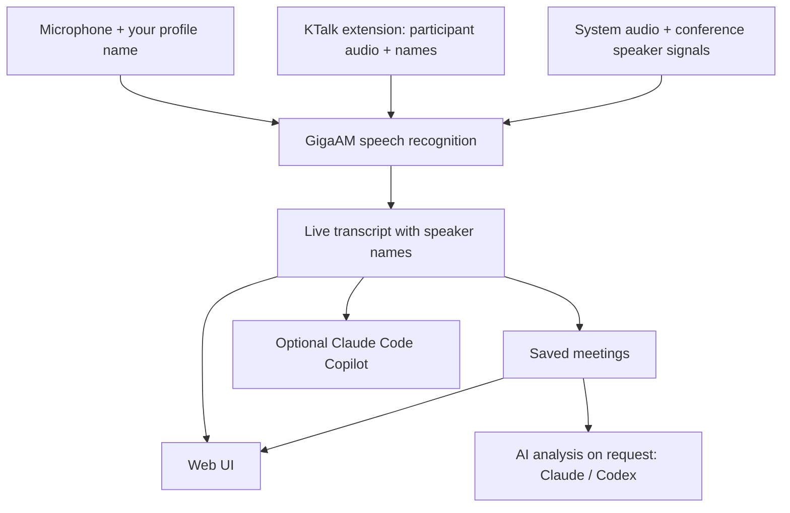

# recog

Live transcription of Russian-language meetings on your own machine, with
speaker names, saved meetings and a web UI. Runs on macOS and Linux. Speaker
names come from conference participant signals and your profile, not from
voice recognition.

## Installation

**Recording:** setup starts the services, and the default live service then
captures microphone and system audio, including between conferences. Meeting
audio is deleted after 24 hours; transcripts stay until you remove them. For
browser KTalk calls only, configure [`--ktalk-only`](docs/usage.md#usage);
this mode requires the extension.

```bash
git clone <repo-url> recog && cd recog
./setup.sh --dry-run  # preview the installation plan without changes
./setup.sh
```

Requires **Python 3.12+ (3.12 recommended)**, **ffmpeg**, and either **macOS 13+ on Apple Silicon**
or **Linux**. macOS needs `swiftc` to build the audio helper; Linux needs
PulseAudio or PipeWire with `pipewire-pulse`, `parec`, `pactl` and PortAudio.
Install **Node.js + npm** to build the Chrome extension. Copilot, an optional
Claude Code session that follows the meeting and answers in a chat, additionally
needs **tmux + Claude Code**; run `claude` once to sign in.
Allow roughly **4 GB for models**. See [requirements and install options](docs/usage.md#requirements).

Setup reports missing dependencies with installation hints. It creates or
reuses the virtualenv, installs Python packages, creates configuration files
on a first install, builds the extension, prepares model weights and installs and starts
services. Existing environment files are preserved. If readiness checks fail,
services are not activated and previously running services are left running.

1. Open `chrome://extensions`, enable **Developer mode**, choose **Load unpacked**
   and select `browser-extension/dist/`.
2. On macOS, grant **Screen Recording** and microphone permissions when prompted.
3. Open **http://127.0.0.1:9080** and set your name for microphone transcripts.

`--dry-run` shows the plan without installing, downloading, writing files or
controlling services; it does **not** verify dependencies or readiness.
Other setup flags: `--no-services`, `--no-prefetch`, `--no-extension`, `--no-env`.
If you do not need Copilot, use `RECOG_SKIP_COPILOT_CHECK=1 ./setup.sh`.

### Python on Linux

Use **Python 3.12**, the version used in CI. Setup tries `python3.12`,
`python3.13`, then `python3`; it rejects versions below 3.12 and warns above
3.13. Acceptance by the installer is not a dependency compatibility guarantee.

**Arch Linux:** the stock Python 3.14.7, tested on 2026-09-19, fails during GigaAM installation
with `No matching distribution found for onnxruntime==1.23.*`. Use Python 3.12
via uv below; upgrading the system `python` package does not solve this pin.

On Ubuntu 22.04, the stock Python is 3.10 and the default repositories do not
provide `python3.12` / `python3.12-venv`. If the required Python is unavailable,
install it for your user with [uv](https://docs.astral.sh/uv/guides/install-python/)
and rerun setup from the repository root (Bash):

```bash
# Requires curl and CA certificates; skip the first line if uv is installed.
curl -LsSf https://astral.sh/uv/install.sh | env UV_UNMANAGED_INSTALL="$HOME/.local/bin" sh
export PATH="$HOME/.local/bin:$PATH"
uv python install 3.12
python3.12 --version
./setup.sh
```

The `PATH` line makes both uv and `python3.12` visible in the current shell;
repeat it in a new shell if `~/.local/bin` is not already on your PATH.
This leaves the system `python3` unchanged. Setup creates its own virtualenv
with pip; you do not need to create one with `uv venv` first.

If a failed attempt already created `venv-gigaam` with another Python version,
setup will reuse it. With services and manual Recog processes stopped, preserve
that environment and let setup create a new one (choose an unused backup name):

```bash
mv venv-gigaam venv-gigaam.previous
./setup.sh
```

The Python 3.12.14 dependency installation, `pip check`, CLI and ASR/web/MCP
imports passed in clean Ubuntu 22.04 and Arch containers on 2026-09-19; audio
capture and service activation were not part of these checks.

## How it works



KTalk supplies per-participant audio through the Chrome extension; a second
recognition pass refines the live text. Jitsi, Element Call and Google Meet use
system audio with conference speaker signals. Microphone speech uses your saved profile.
System audio outside a recognized conference has no speaker identity and is
marked `Unknown`.
GigaAM runs locally on CUDA, MPS or CPU, or through an optional
[remote ASR gateway](docs/asr-server.md) with local fallback.

The web UI shows live and saved transcripts, audio playback and AI analysis.
Start Copilot from the web UI; automatic meeting startup is off on fresh
installs. New installations keep meetings, logs and settings in `~/.recog`.

The bundled [`recog-meetings` skill](.claude/skills/recog-meetings/SKILL.md)
lets Claude Code search saved transcripts by speaker, keyword and date, find
quotes with context, and list meetings and participants. Ask, for example,
“Find what we discussed about the release last week.” You can also run its search directly:

```bash
uv run .claude/skills/recog-meetings/search_meetings.py --text "релиз" --context 2
```

## Everyday commands

```bash
./recog-service.sh status     # service state
./recog-service.sh logs       # live transcription logs
./recog-service.sh stop       # stop services and recording
./recog-service.sh start      # start after readiness checks

git pull && ./setup.sh        # update dependencies, units and running services
```

On Linux, `loginctl enable-linger "$USER"` keeps user services alive after logout.
After rebuilding the extension, reload it in `chrome://extensions`.

## Documentation

- [Usage, configuration and troubleshooting](docs/usage.md)
- [Conference hosts](docs/conference-hosts.md) and [desktop KTalk](docs/desktop-ktalk.md)
- [Repository layout and upgrade steps](docs/repository-layout.md)
- [Documentation index](docs/README.md) and [architecture decisions](docs/adr/)
- [Development checks](docs/usage.md#testing) and [quality gates](docs/quality.md)

## License

MIT
