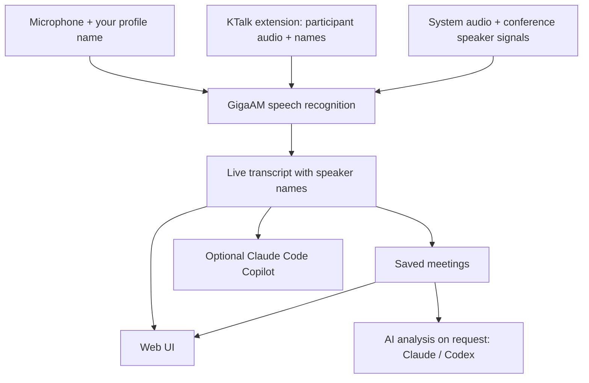

# recog

Russian speech recognition with live speaker identification, saved meetings
and a web UI. Runs on macOS and Linux.

## Installation

```bash
git clone <repo-url> recog && cd recog
./setup.sh --dry-run  # preview the installation plan without changes
./setup.sh
```

Requires **Python 3.12+**, **ffmpeg**, and either **macOS 13+ on Apple Silicon**
or **Linux**. macOS needs `swiftc` to build the audio helper; Linux needs
PulseAudio or PipeWire with `pipewire-pulse`, `parec`, `pactl` and PortAudio.
Install **Node.js + npm** to build the Chrome extension. Copilot additionally
needs **tmux + Claude Code**; run `claude` once to sign in.
Allow roughly **4 GB for models**. See [requirements and install options](docs/usage.md#requirements).

Setup reports missing dependencies with installation hints. It creates or
reuses the virtualenv, installs Python packages, creates missing configuration
files, builds the extension, prepares model weights and installs and starts
services. Existing environment files are preserved. If readiness checks fail,
services are not activated and previously running services are left running.

1. Open `chrome://extensions`, enable **Developer mode**, choose **Load unpacked**
   and select `browser-extension/dist/`.
2. On macOS, grant **Screen Recording** and microphone permissions when prompted.
3. Open **http://127.0.0.1:9080** and set your name for microphone transcripts.

`--dry-run` shows the plan without installing, downloading, writing files or
controlling services; it does **not** verify dependencies or readiness.
Other setup flags: `--no-services`, `--no-prefetch`, `--no-extension`, `--no-env`.
If you do not need Copilot, use `RECOG_SKIP_COPILOT_CHECK=1 ./setup.sh`.

**Recording:** the default live service captures microphone and system audio,
including between conferences. For browser KTalk calls only, configure
[`--ktalk-only`](docs/usage.md#usage); this mode requires the extension.

## How it works



KTalk supplies per-participant audio through the Chrome extension; a second
recognition pass refines the live text. Jitsi and Element Call use system audio
with conference speaker signals. Microphone speech uses your saved profile.
GigaAM runs locally on CUDA, MPS or CPU, or through an optional
[remote ASR gateway](docs/asr-server.md) with local fallback.

The web UI shows live and saved transcripts, audio playback and AI analysis.
Start Copilot from the web UI; automatic meeting startup is off on fresh
installs. New installations keep meetings, logs and settings in `~/.recog`.

## Everyday commands

```bash
./recog-service.sh status     # service state
./recog-service.sh logs       # live transcription logs
./recog-service.sh stop       # stop services and recording
./recog-service.sh start      # start after readiness checks

git pull && ./setup.sh        # update dependencies, units and running services
```

On Linux, `loginctl enable-linger "$USER"` keeps user services alive after logout.
After rebuilding the extension, reload it in `chrome://extensions`.

## Documentation

- [Usage, configuration and troubleshooting](docs/usage.md)
- [Conference hosts](docs/conference-hosts.md) and [desktop KTalk](docs/desktop-ktalk.md)
- [Repository layout and upgrade steps](docs/repository-layout.md)
- [Documentation index](docs/README.md) and [architecture decisions](docs/adr/)
- [Development checks](docs/usage.md#testing) and [quality gates](docs/quality.md)

## License

MIT
