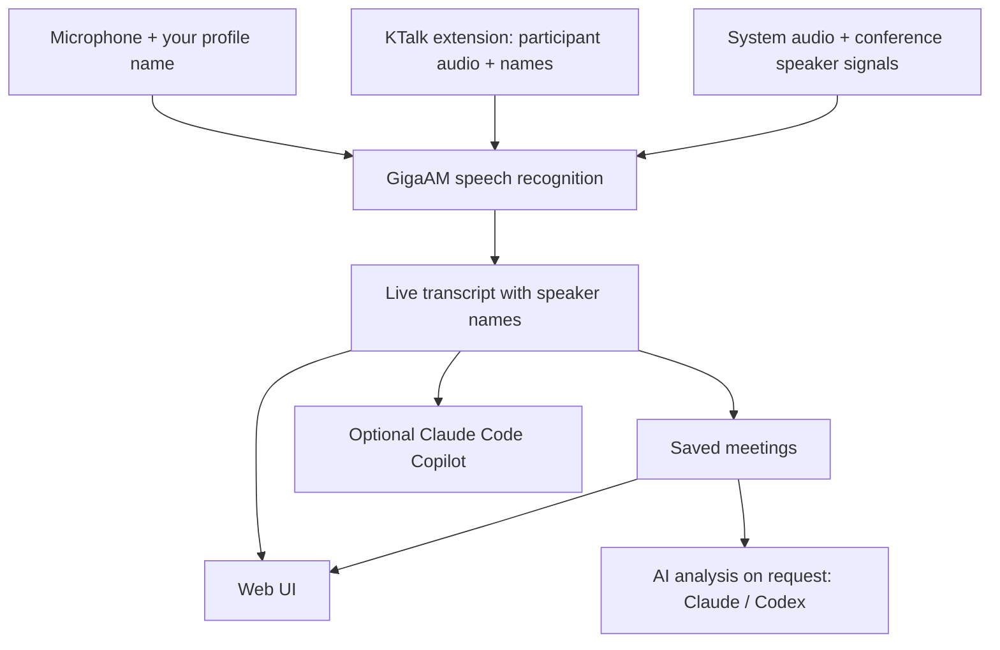

# recog

Live transcription of Russian-language meetings on your own machine, with
speaker names, saved meetings and a web UI. Speaker names come from conference
participant signals and your profile, not from voice recognition. Supported
conferences: KTalk (Kontur Talk, `*.ktalk.ru`), Jitsi and Google Meet.

Runs on macOS and Linux. Linux is covered by the automated tests on Ubuntu and
by the [installation checks](docs/usage.md#python-on-linux); live audio capture and
service activation there have no recorded end-to-end run.

## Installation

**Recording:** setup starts the services, and the default live service then
captures microphone and system audio, including between conferences. Meeting
audio is deleted after 24 hours; transcripts stay until you remove them. The
recording includes other participants' speech: tell them, and make sure you
are allowed to record. `./recog-service.sh stop` stops the services and the
recording; `./setup.sh --no-services` installs without starting them. To record
during browser KTalk calls only, configure
[`--ktalk-only`](docs/usage.md#recording-only-during-ktalk-calls); this mode
requires the extension.

Before running setup, have:

- **macOS 13+ on Apple Silicon** (with `swiftc` to build the audio helper) or
  **Linux** (PulseAudio or PipeWire with `pipewire-pulse`, `parec`, `pactl` and
  PortAudio).
- **Python 3.12**. On Linux without it, follow
  [Python on Linux](docs/usage.md#python-on-linux) first.
- **ffmpeg**, **Node.js + npm** to build the Chrome extension, and roughly
  **4 GB for models**.
- For Copilot, an optional Claude Code session that follows the meeting and
  answers in a chat: **tmux + Claude Code**; run `claude` once to sign in.
  Setup requires both unless you [skip the Copilot check](docs/usage.md#copilot).

```bash
git clone https://github.com/materkey/recog.git && cd recog
./setup.sh --dry-run  # preview only; does not check dependencies or readiness
./setup.sh            # without Copilot: RECOG_SKIP_COPILOT_CHECK=1 ./setup.sh
```

Setup prints missing dependencies and how to install them; fix these and rerun
setup. See [requirements and install options](docs/usage.md#requirements).

1. Open `chrome://extensions`, enable **Developer mode**, choose **Load unpacked**
   and select `browser-extension/dist/`.
2. On macOS, grant **Screen Recording** and microphone permissions when prompted.
3. Open **http://127.0.0.1:9080** and set your name for microphone transcripts.
4. Say a phrase or join a conference: the text appears on the **Live** page.
   No text? Check `./recog-service.sh status` and `./recog-service.sh logs`,
   then [troubleshooting](docs/usage.md#troubleshooting).

## How it works



Microphone speech uses your saved profile.
System audio outside a recognized conference has no speaker identity and is
marked `Unknown`.
Speech recognition (GigaAM) runs locally by default; a
[remote ASR gateway](docs/asr-server.md) is optional, and so are Copilot and
AI analysis, which use the Claude and Codex CLIs.

The web UI shows live and saved transcripts, audio playback and AI analysis.
Start Copilot from the web UI; automatic meeting startup is off on fresh
installs. New installations keep meetings, logs and settings in `~/.recog`.

The bundled [`recog-meetings` skill](.claude/skills/recog-meetings/SKILL.md)
lets Claude Code search saved transcripts by speaker, keyword and date.

## Everyday commands

```bash
./recog-service.sh status     # service state
./recog-service.sh logs       # live transcription logs
./recog-service.sh stop       # stop services and recording
./recog-service.sh start      # start after readiness checks
```

## Documentation

- [Usage, configuration and troubleshooting](docs/usage.md), including
  [updating an install](docs/usage.md#updating-an-existing-install)
- [Conference hosts](docs/conference-hosts.md) and [desktop KTalk](docs/desktop-ktalk.md)
- [Documentation index](docs/README.md): repository layout, architecture
  decisions, development checks

## License

[MIT](LICENSE)
